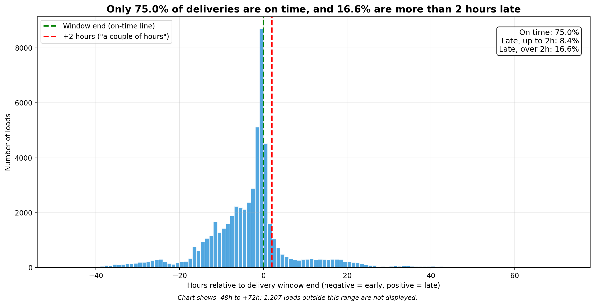
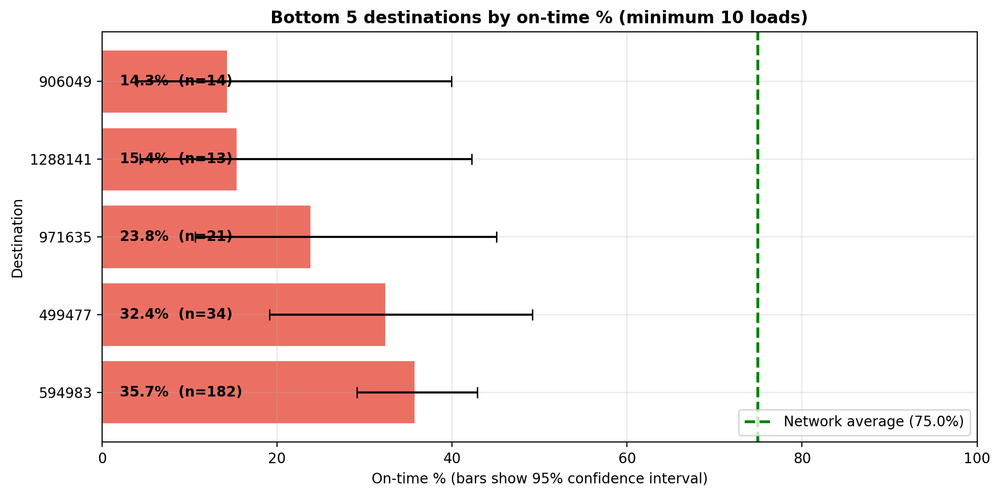
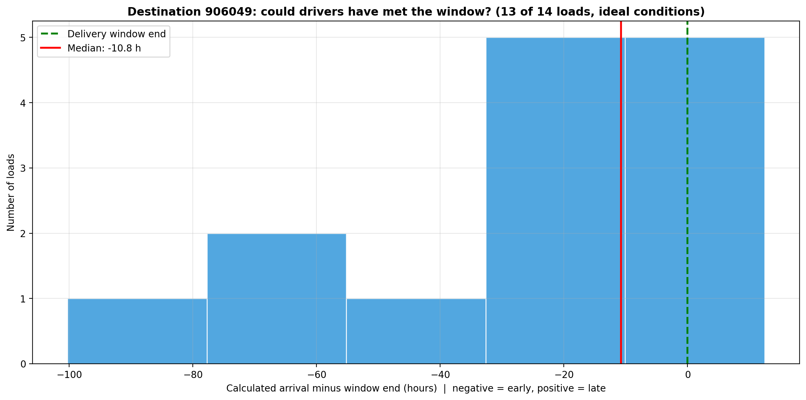

# Delivery-Performance
## Overview
This project analyzes truckload delivery performance data to validate customer claims, identify operational bottlenecks, and provide data-driven recommendations for supply chain optimization. Using Python and advanced data analytics techniques, this analysis examines 59,099 truckload deliveries (sample case-study data) that tests  delivery records to assess on-time performance, pinpoint problem locations, and diagnose root causes of delivery delays.

## Key Findings
| Question | Finding |
|---|---|
| Is the customer on time ~90% of the time? | **No: 75.0%** of deliveries arrive at or before the window end (73.0% if arriving exactly at the end counts as late) |
| Is it just near-misses? | **No.** Even with a 2-hour grace period, on-time reaches only 83.4% |
| Are late deliveries late by "a couple of hours"? | **No.** The median late delivery is 5.5 h late; 66.4% of late loads exceed 2 h; the worst 10% exceed 36 h |
| Which destinations struggle most? | Five destinations are on time only 14%–36% of the time (see below); most rest on small samples |
| Could drivers have met the windows at the worst destination? | **On paper yes (13 of 14 loads), but only 9 of 14 once a simple rest rule is added** |

### Key Business Questions Answered:       
1. Does the data support the customer's claim of 90% on-time performance?
2. Which delivery locations are the most problematic?
3. Are delivery time windows realistic for worst-performing locations?
### Business Problem
A logistics customer believes they mantain:
* 90% on-time delivery performance across their network
* Minimal delays of only "a couple of hours at most" when drivers are late

This analysis validates these claims and identifies areas for operational improvement using historical truckload data.

### 📊 Dataset Description
Four CSV files of sample truckload data (`delivery_data/sample_data1.csv` to
`sample_data4.csv`). Each row is one load with booking, pickup and delivery windows and
actual arrival/departure times, plus mileage.
| | |
|---|---|
| Raw records | 59,529 |
| Removed: invalid destination ID (Excel `#VALUE!` error) | 1 |
| Removed: missing delivery times | 429 |
| **Analyzable loads** | **59,099** |
| Origins / destinations | 1,676 / 2,343 |
| Delivery period | May 2020 – December 2021 |
| Average distance | 459 miles |
| Destinations with at least 10 loads | 463 (covering 92.7% of loads) |


 ## Key Variables
| Variable|Description|
| --------| --------- |
| `LOAD_ID`| Unique identifier for each load |
| `ORIG` | Origin location code |
| `DEST` | Destination location code
| `PKUP_ST_DT/TM` | Proposed pickup window start (date/time)|
| `PKUP_END_DT/TM` | Proposed pickup window end (date/time) |
| `PKUP_ARRIVAL_ACT_DT/TM` | Actual pickup arrival (date/time) code |
| `PKUP_DEPARTURE_ACT_DT/TM` | Actual pickup departure (date/time) |
| `DLVERY_ST_DT/TM` | Proposed delivery window start (date/time) |
| `DLVERY_END_DT/TM` | Proposed delivery window end (date/time) |
| `DLVERY_ARRIVAL_ACT_DT/TM` | Actual delivery arrival (date/time) |
| `DLVERY_DEPARTURE_ACT_DT/TM` | Actual delivery departure (date/time) |
| `MILEAGE` | Total miles for the route |

### Technologies & Tools
Programming Language
Python 3.8+

Libraries Used:
* pandas          # Data manipulation and analysis
* numpy           # Numerical computations
* matplotlib      # Data visualization
* seaborn         # Statistical data visualization
* datetime        # Date and time handling

Development Environment
- Jupyter Notebook - Interactive data analysis and visualization

### 📁  Project Structure

```
Delivery-Performance/
├── Delivery_Performance.ipynb   # full analysis, cells run in order
├── delivery_data/               # four sample CSV files
├── visualizations/              # charts used in this README
├── requirements.txt
└── README.md
```

### Analysis Methodology

**1. Data Preprocessing**

* Load and inspect raw CSV data
* Convert date/time strings to datetime objects
* Handle missing values and data quality issues
* Create calculated fields for analysis

**2. Performance Metrics Calculation**

(python)
##### Key metrics calculated:
- Delivery delay (hours) = Actual arrival - Window end time
- On-time status = True if delay ≤ 0
- Pickup dwell time = Departure time - Arrival time

**3. Statistical Analysis**

* Descriptive Statistics: Mean, median, standard deviation of delays
* Percentage Analysis: On-time performance rates by location
* Trend Analysis: Performance over time (monthly trends)
* Variability Analysis: Standard deviation of delays by location

**4. Diagnostic Testing**

Simulated optimal delivery scenario:

* Driver arrives at pickup window start
* Dwell time = 90th percentile by origin
* Travel speed = 40 mph constant
* Calculate if windows are achievable

## 📈 Key Findings
### Question 1: Overall Performance Validation
#### On-Time Performance
#### 1. Does the data support the customer's claim?



| Measure | Result |
|---|---|
| On time (arrival ≤ window end) | 75.0% |
| On time (arrival strictly before window end) | 73.0% |
| Late loads | 14,798 (25.0%) |
| Median delay when late | 5.5 h |
| 90th percentile delay when late | 36.1 h |
| 99th percentile delay when late | 106.8 h |
| Share of late loads more than 2 h late | 66.4% |
| Share of all loads more than 2 h late | 16.6% |

**Is the miss just near-misses?** No. Allowing a grace period after the window end:

| Grace period | On-time % |
|---|---|
| 0 min | 75.0% |
| 15 min | 77.1% |
| 30 min | 78.6% |
| 60 min | 80.7% |
| 120 min | 83.4% |

Even a two-hour tolerance leaves on-time performance 6.6 points below the customer's 90%.
For context, the median delivery window across the network is only 1.0 hour long, which
leaves little room for variability.


### Question 2: Problem Locations Identified
#### Which locations are the most problematic? (minimum 10 loads)



**Bottom 5 by on-time percentage** (network average: 75.0%)

| Rank | Destination | Loads | On time | On-time % | 95% CI | Median delay (h) | Max delay (h) |
|---|---|---|---|---|---|---|---|
| 1 | 906049 | 14 | 2 | 14.3% | 4.0–39.9% | 0.5 | 26.8 |
| 2 | 1288141 | 13 | 2 | 15.4% | 4.3–42.2% | 4.1 | 23.6 |
| 3 | 971635 | 21 | 5 | 23.8% | 10.6–45.1% | 1.2 | 69.4 |
| 4 | 499477 | 34 | 11 | 32.4% | 19.1–49.2% | 0.4 | 27.4 |
| 5 | 594983 | 182 | 65 | 35.7% | 29.1–42.9% | 5.1 | 102.0 |

*Median delay is across all loads at the destination. Two destinations tie at 35.7% for fifth
place: 594983 (65 of 182) and 1498907 (5 of 14). 594983 is listed because ties are broken by
larger median delay (5.1 h vs 0.8 h); it also has far more loads. Four of the five rank on
13–34 loads, so individual rates are imprecise, and having been selected as the worst of 463
destinations they likely overstate how bad each one truly is. All five intervals sit well
below the network average.*

**Highest delay variability** (standard deviation of delivery arrival minus window end)

*Raw data, as the case study asks:*

| Rank | Destination | Loads | Std dev (h) | IQR (h) | Median (h) | Extreme record |
|---|---|---|---|---|---|---|
| 1 | 1492753 | 22 | 1,397.3 | 8.7 | -13.5 | 274 days early |
| 2 | 1012707 | 54 | 1,201.0 | 2.2 | -0.2 | 368 days late |
| 3 | 53363 | 106 | 706.6 | 4.1 | -1.6 | 303 days late |
| 4 | 1302285 | 77 | 419.4 | 4.5 | -4.5 | 153 days early |
| 5 | 2061913 | 28 | 417.8 | 1.8 | -0.3 | 92 days early |

Each value is almost entirely caused by one implausible timestamp; the typical spread (IQR)
at all five is under 9 hours.

*After excluding flagged records (see Data quality):*

| Rank | Destination | Loads | Std dev (h) | IQR (h) | Median (h) |
|---|---|---|---|---|---|
| 1 | 1822349 | 60 | 99.6 | 167.0 | -90.9 |
| 2 | 1599683 | 14 | 59.2 | 96.3 | -8.3 |
| 3 | 1281579 | 12 | 54.4 | 8.8 | -2.5 |
| 4 | 1276513 | 13 | 53.3 | 29.2 | -7.4 |
| 5 | 1584927 | 12 | 52.2 | 81.0 | -8.0 |

Destination 1822349 shows genuinely wide spread (IQR 167 h). Its typical load arrives about
3.8 days *before* the window end, so it is an early-arrival pattern, not a late one. Its
spread is not explained by long windows (median window length is 0 hours). The data cannot
show whether this reflects real early deliveries or inaccurate appointment dates, and this
analysis does not assume either. Destination 1281579 is driven by a few extreme loads (IQR
only 8.8 h). The 30-day cutoff is an analyst judgment.


### Question 3: Diagnostic Test Results
#### Could drivers have met the windows? (worst destination: 906049)



Destination 906049 has the lowest on-time rate (2 of 14 loads). All 14 loads travel one lane
(origin 1324589, 460 miles, an 11.5-hour drive at 40 mph).

| Scenario | Loads that could meet the window | Median slack |
|---|---|---|
| Case-study assumptions (arrive at window start, p90 dwell, 40 mph, no rest) | 13 of 14 (93%) | 10.8 h |
| Plus a simplified rest rule (10 h rest after 11 h of driving) | 9 of 14 (64%) | 0.8 h |

**Where the time actually went:** pickup arrival (−4.4 to +6.0 h versus window start) and
dwell time (−1.0 to +1.9 h versus the 90th percentile) explain little. The main gap is time
between pickup departure and delivery: a median of 10.8 hours beyond the 11.5-hour driving
estimate. That is similar in size to the rest period, which fits rest as a cause but does not
prove it. Six of the 12 late loads arrived within about 30 minutes of the window end.

**Interpretation:** the windows are achievable on paper, so they are not impossible by
design, but they leave almost no margin once required rest is included. With 14 loads on a
single lane, this is a diagnostic, not a network-wide conclusion.

### Data quality

| Check | Result |
|---|---|
| Flagged as suspect (kept, not removed) | 90 loads (0.15%) |
| Delivery window ends before it starts | 57 |
| Delivery window longer than 7 days | 28 |
| Arrival more than 30 days after / before window end | 5 / 13 |

Some records meet more than one test. **The conclusion does not depend on them:** on-time is
74.96% with all loads and 74.99% with flagged loads excluded. They matter for variability:
the 18 extreme-delay records (0.03% of loads) fully explain the raw variability ranking.

**Location ID bug:** one source file had an Excel formula error (`#VALUE!`) in its destination
column. That forced the column to text type, so the same destination code was stored as a
number in three files and as text in the fourth. Destinations were split into two groups
(3,182 destinations before the fix, 2,343 after). The record was removed, IDs were
standardized as text, and every location-level result was recomputed.

### Assumptions and limitations

- This is sample case-study data; conclusions describe this sample, not a real network.
- Timestamps are treated as local times with no time-zone adjustment.
- The diagnostic ignores traffic, weather, and detailed hours-of-service rules. The rest-rule
  sensitivity is a simplification, not a full hours-of-service model.
- The diagnostic covers one destination, one lane, and 14 loads.
- Bottom-5 destinations rest on small samples and are selected as extremes, so their true
  rates are probably better than observed.
- The 30-day outlier cutoff, the 10-load minimum, and the tie-breaking rule are analyst
  judgments.


 ### 💡 Business Recommendations
🎯 **Immediate Actions**
1. Window Optimization
    - Review and adjust delivery windows for bottom 5 performing locations
    - Consider adding buffer time for high-mileage routes
2. Performance Monitoring
    - Implement real-time dashboards for location-specific KPIs
    - Set up automated alerts for at-risk deliveries
3. Operational Efficiency
    - Reduce pickup dwell times through better scheduling
    - Optimize route planning for problem destinations

📈 **Long-Term Strategies**

4. Customer Communication
    - Set realistic delivery expectations based on data
    - Proactive notification system for potential delays
5. Continuous Improvement
    - Monthly performance reviews with corrective action plans
    - Driver training programs focused on problem locations
6. Data-Driven Decision Making
    - Expand analysis to include seasonal trends
    - Develop predictive models for delivery performance


### 🎓 Learning Outcomes

This project demonstrates proficiency in:

- ✅ Data Wrangling: Cleaning and transforming complex datetime data
- ✅ Statistical Analysis: Calculating performance metrics and variability measures
- ✅ Data Visualization: Creating professional, publication-ready charts
- ✅ Business Analytics: Translating data insights into actionable recommendations
- ✅ Supply Chain Management: Understanding logistics KPIs and operational metrics
- ✅ Python Programming: Using pandas, numpy, and matplotlib effectively
- ✅ Problem Solving: Diagnosing root causes of operational issues

### 🔮 Future Enhancements
**Potential Improvements**

- [ ] Predictive Modeling: Build ML models to predict late deliveries
- [ ] Interactive Dashboard: Create web-based dashboard using Plotly/Dash
- [ ] Route Optimization: Integrate with mapping APIs for route analysis
- [ ] Seasonal Analysis: Examine performance patterns by season/quarter
- [ ] Cost Analysis: Calculate financial impact of delays
- [ ] Real-Time Monitoring: Connect to live data feeds for real-time tracking
- [ ] Driver Performance: Analyze individual driver performance metrics